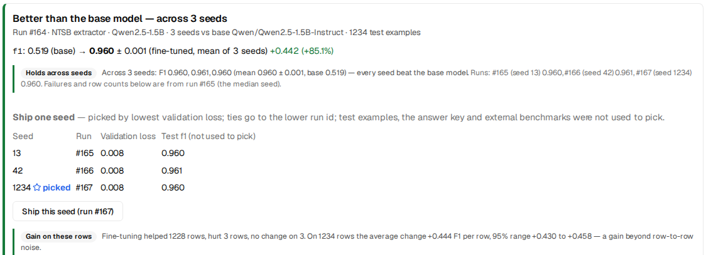

<p align="center">
  
</p>

# BrewSLM

> Local-first platform to build, evaluate and ship small language models, with a judged check of whether retrieval beats fine-tuning before you train.

**[Website](https://brewslm.com)** · **[Docs](./slm-docs/docs/getting-started/quickstart.md)** · **[Blog](https://brewslm.com/blog.html)** · **[Academy](https://brewslm.com/academy/)** · **[Model on Hugging Face](https://huggingface.co/TensorGreed/brewslm-sensitive-data-tagger)** · **[YouTube](https://www.youtube.com/@brewslm)** · **[Changelog](./CHANGELOG.md)**

BrewSLM takes you from documents or rows to a shipped model: clean and split your data, generate training pairs with a local or cloud model, train (LoRA, full, continued pretraining, distillation, token classification), read a judged before-and-after verdict with noise intervals, and export GGUF or publish to the Hugging Face Hub. Two measured runs:

- **[RAG vs fine-tuning on IRS Publication 17](https://brewslm.com/blog-irs-pub17-fine-tune-lost-retrieval-won.html):** base model 0.17, base + retrieved passages 0.73, fine-tuned 0.02 on the same 41 judged questions. The pre-training check called it before training.
- **[A sensitive-data tagger with no labelled data](https://brewslm.com/blog-sensitive-data-detector-from-zero.html):** 30 types, span F1 0.97 on a 44-text answer key, 0.78 on Gretel PII; [published on the Hub](https://huggingface.co/TensorGreed/brewslm-sensitive-data-tagger).

This repository contains the FastAPI backend and React frontend.

## Quick Start (Local Dev)

This path gets a fresh clone to a completed (simulated) training run with a loss curve in about ten minutes on a laptop, no GPU, no Redis. The full docs live in [`slm-docs/`](./slm-docs/docs/getting-started/quickstart.md) (run them locally with `cd slm-docs && npm install && npm run start`, then open `http://localhost:3001`).

### Prerequisites

- Python 3.11+ (CI runs 3.12). On Ubuntu the binary is `python3`.
- Node.js 20.19+ or 22.12+ (Vite 7 requires one of these)
- For **real** training only: Redis plus a Celery worker (step 3) and, for anything but tiny models, an NVIDIA GPU. The no-GPU block in step 1 needs neither.

### 1. Install and configure the backend

```bash
git clone https://github.com/TensorGreed/__SLM__.git brewslm
cd brewslm/backend
python3 -m venv .venv
source .venv/bin/activate
pip install -r requirements.txt     # CPU profile; GPU profile: see "GPU install" below
cp .env.example .env                # the backend reads backend/.env (run it from backend/)
```

`.env.example` sets `AUTH_BOOTSTRAP_API_KEY`, which makes `admin` an admin. Without a `.env`, `admin` is created as an engineer with no project access.

> **No GPU, no Redis? Use simulated training.** The defaults are `TRAINING_BACKEND="external"` (real training through a Celery worker) and `ALLOW_SIMULATED_TRAINING=false`, so without a worker a run stays queued. To try the whole flow without a GPU or Redis, set these two lines in `backend/.env`:
>
> ```bash
> sed -i.bak 's/^TRAINING_BACKEND=.*/TRAINING_BACKEND="simulate"/; s/^ALLOW_SIMULATED_TRAINING=.*/ALLOW_SIMULATED_TRAINING=true/' .env && rm .env.bak
> ```
>
> (`-i.bak` works with both GNU and macOS sed. Or edit the two lines by hand: `TRAINING_BACKEND="simulate"` and `ALLOW_SIMULATED_TRAINING=true`.)
>
> A simulated run walks the real pipeline and draws a loss curve, but it trains no weights: it is **not evaluated** against the base model, so there is no verdict on Results. Skip step 3 (Celery) in this mode.

### 2. Create the database and start the backend

```bash
# still in backend/, venv active
uvicorn app.main:app --port 8000     # first boot creates data/slm_platform.db and its tables;
                                     # wait for "Application startup complete", then Ctrl-C
alembic stamp head                   # once, on a fresh DB
uvicorn app.main:app --reload --port 8000
```

Do not run `alembic upgrade head` on a DB that was never stamped: some early migrations use `ALTER COLUMN`, which SQLite refuses. After the stamp, run `alembic upgrade head` whenever you pull schema changes. Check it is up: `curl http://localhost:8000/api/health`. Swagger UI: `http://localhost:8000/docs`.

### 3. Worker (Celery) — real training only

Skip this in simulate mode. Real training (the default `TRAINING_BACKEND=external`), compression and remote imports need Redis and a worker in another terminal, from the repo root:

```bash
cd backend
source .venv/bin/activate
celery -A app.worker.celery_app worker --loglevel=INFO --pool=threads --concurrency=2
```

`.env.example` points Redis at `redis://localhost:6379/0` (broker) and `/1` (results); change the DB index in `REDIS_URL`, `CELERY_BROKER_URL` and `CELERY_RESULT_BACKEND` if another local app uses them. If long-running tasks (for example training jobs >1 hour) are re-received repeatedly with the same task id, set `CELERY_VISIBILITY_TIMEOUT_SECONDS` in `backend/.env` to a larger value (for example `43200`). The worker ignores a re-delivered training task whose run already finished or whose training process is still alive, so a re-delivery never starts a second training process; keep the visibility timeout above your longest training time limit anyway (preflight warns when a run's limit is longer).

### 4. Frontend

In a second terminal, from the repo root:

```bash
cd frontend
npm ci
npm run dev
```

Open `http://localhost:5173`.

**Other ports.** The UI calls `/api` on its own origin and Vite proxies it to `VITE_API_PROXY_TARGET` (default `http://localhost:8000`), so the browser never needs CORS. To run the backend on 8100 and the UI on 5180:

```bash
# backend/
uvicorn app.main:app --reload --port 8100
# frontend/
VITE_API_PROXY_TARGET=http://localhost:8100 npm run dev -- --port 5180 --strictPort
```

Use `--strictPort`: without it, Vite silently moves to the next free port when the one you asked for is taken. `CORS_ORIGINS` in `backend/.env` only matters if a browser page on another origin calls the API directly.

### 5. Log in and run the demo

1. Open `http://localhost:5173` and sign in (auth is on by default, `AUTH_ENABLED=true`): username `admin`, password the `API_KEY` from `backend/.env` (default `sk-mock-admin-key`). If OIDC is configured, use **Sign in with SSO** instead.
2. On the project list, find the **Demo · Support FAQ** starter and click **Open demo**. It creates a project with a CSV of support Q&A rows, a hand-labelled answer key and prepared splits.
3. On the project's **Overview**, follow the next step **Run and monitor training**, then on **Train** click **Train** and **Launch** in the confirmation dialog.
4. In simulate mode the run completes in under a minute with a loss curve on the **Train** page. With a real backend, the automatic lift check then scores the run against its base model, and **Results** → **Verdict** says whether it beat the base model and whether the change is more than noise.

   A real verdict looks like this (an NTSB accident-report narrative-to-JSON extractor: 3 seeds, 1,234 test reports):

   

The workspace sections are **Overview / Data / Train / Results / Ship / Settings**. A blank project needs data first (**Data**: upload a file, import a dataset or generate examples) before Train or the Autopilot planner can run.

### 6. API and CLI (auth on)

With auth on, every API call needs a Bearer token. Log in once and reuse it:

```bash
TOKEN=$(curl -s -X POST http://localhost:8000/api/auth/local/login \
  -H "Content-Type: application/json" \
  -d '{"username": "admin", "password": "sk-mock-admin-key"}' | python3 -c 'import sys, json; print(json.load(sys.stdin)["token"])')
curl -H "Authorization: Bearer $TOKEN" http://localhost:8000/api/projects
```

The CLI is `./brewslm` at the repo root (not on your `PATH`). It talks to `http://127.0.0.1:8000/api` unless you pass `--api-base` or set `BREWSLM_API_BASE` (a bare `http://host:port` gets `/api` added):

```bash
./brewslm auth login --username admin --password sk-mock-admin-key --save   # writes ~/.brewslm/token, used from then on
./brewslm doctor --project 1
BREWSLM_API_BASE=http://127.0.0.1:8100 ./brewslm doctor --project 1          # a backend on another port
```

`BREWSLM_TOKEN` or `--token` overrides the saved token. `doctor` exits 0 on PASS or WARN (an optional item such as a missing teacher key), 1 on FAIL; add `--strict` to make WARN exit non-zero too.

### GPU install

```bash
# GPU profile (all non-torch deps):
pip install -r requirements-gpu.txt
# then install a CUDA-enabled torch wheel that matches your OS/arch/CUDA stack.
# Example only (Linux x86_64 + CUDA 12.8):
# pip install -r requirements-gpu-cu128.txt
# Optional but required for native DPO/ORPO pairwise training:
# pip install trl
```

Notes:
- Default local DB is SQLite (`sqlite+aiosqlite:///./data/slm_platform.db`); a relative SQLite path resolves against the repo root, so it is the same file whichever directory you start from.
- With `ALLOW_SQLITE_AUTOCREATE=true` (default), tables auto-create on startup. Existing tables are not migrated by it: that is what `alembic upgrade head` is for.
- For Linux aarch64 systems, use your vendor/official CUDA torch wheel (PyPI `torch` is often CPU-only).
- Verify torch runtime before training:

```bash
cd backend
source .venv/bin/activate
python - <<'PY'
import torch
print("torch:", torch.__version__)
print("cuda_available:", torch.cuda.is_available())
print("cuda_devices:", torch.cuda.device_count())
if torch.cuda.is_available():
    print("device0:", torch.cuda.get_device_name(0))
PY
```

### API Docs

With the backend running, visit `http://localhost:8000/docs`.

### Reality Check: Measured vs Estimated vs Simulated

Before you trust a number, check how it was produced:

- `measured`: produced from a live runtime command/probe.
- `estimated`: produced from artifact metadata or heuristic fallback when a live probe cannot run.
- `simulated`: produced by demo/stub runtime paths.

For export optimization specifically (`POST /api/projects/{project_id}/export/optimize`):

- each candidate includes `metric_source`, `metric_sources`, and `measurement`.
- `measurement.fallback_reason` explains why estimated fallback was used.
- `optimization_run` includes measured vs estimated candidate counts for reproducibility.

When strict execution is enabled (`STRICT_EXECUTION_MODE=true`), simulated/stub paths are blocked and API responses return actionable fixes instead of silently falling back.

### Synthetic Generation with Ollama

Use these defaults in the **Synthetic** tab:

- Provider: `Local (Ollama)`
- API URL: `http://localhost:11434/v1/chat/completions`
- Model: `llama3.1:latest` (or any installed Ollama chat model)

Quick checks:

```bash
ollama serve
ollama list
```

If you see `Teacher model response was not valid JSON for Q&A extraction`:

- Update to the latest backend code (parser now tolerates fenced/wrapped JSON and `Q:/A:` text).
- Keep `Pairs to Generate` small at first (`3-8`) and start with a smaller source selection.
- Ensure the model is available locally (`ollama list`) and the API URL is reachable from backend host.

---

## Optional Docker Compose

Repo includes `docker-compose.yml` for:
- Postgres
- Redis
- Backend API
- Celery worker
- Frontend

```bash
docker compose up --build
```

The frontend container (port 80) serves the built UI via `frontend/nginx.conf`, which proxies `/api/` (including WebSockets) to the `backend` service on port 8000. Edit that file if your routing differs.

**GPU training:** compose as shipped does not train on GPU. The worker runs with `TRAINING_BACKEND=external` and its NVIDIA `deploy` block is commented out in `docker-compose.yml`, so real training needs that block enabled on a GPU host (or run the stack natively as described above).

---

## Authentication and Authorization

### Auth modes

- **SSO mode**: enable OIDC vars (`OIDC_CLIENT_ID`, `OIDC_CLIENT_SECRET`, `OIDC_DISCOVERY_URL`)
- **Local mode**: `/api/auth/local/login` returns a JWT token (used by frontend)

### Access control

- Global roles: `admin`, `engineer`, `viewer`
- Project membership roles: `owner`, `editor`, `viewer`
- Request auth supports either:
  - `Authorization: Bearer <jwt-or-api-key>`
  - `x-api-key: <api-key>`
- Audit logs are captured for mutating API calls (configurable via `AUDIT_LOG_ENABLED`)

---

## Pipeline and API Surface

All project-scoped routes are under `/api/projects/{project_id}/...`.

| Domain | Route Prefix | Key Capabilities |
|---|---|---|
| Projects | `/projects` | CRUD, stats, base model metadata |
| Domain Packs | `/domain-packs` | Create/list/get/update pack overlays, hook catalog/reload |
| Domain Profiles | `/domain-profiles` | Create/list/get/update contract profiles |
| Pipeline | `/projects/{id}/pipeline` | Stage status (+ auto-gate summary), graph preview/runtime actions, workflow runs, pipeline recipe resolve/apply |
| Ingestion | `/projects/{id}/ingestion` | Upload/batch upload, remote import (sync + queued), document lifecycle, job status/cancel, WS logs |
| Cleaning | `/projects/{id}/cleaning` | Clean, clean-batch, chunk inspection |
| Gold Set | `/projects/{id}/gold` | Add/import/list/lock evaluation gold data |
| Synthetic | `/projects/{id}/synthetic` | Teacher-model generation + save workflow |
| Dataset Prep | `/projects/{id}/dataset` | Split, preview, schema/profile diagnostics (runtime-aware defaults) |
| Tokenization | `/projects/{id}/tokenization` | Token stats + vocab sample |
| Training | `/projects/{id}/training` | Experiments, config preflight, start/cancel, status, task status, WS telemetry/logs (runtime-aware defaults) |
| Comparison | `/projects/{id}/training/compare` | Compare up to 5 experiments side by side |
| Evaluation | `/projects/{id}/evaluation` | Exact Match/F1/Safety, LLM judge, held-out evaluation, scorecards, eval pack preferences, auto-gate reports |
| Compression | `/projects/{id}/compression` | Quantize/merge/benchmark queue, report status, task status/cancel, WS logs |
| Export | `/projects/{id}/export` | Create/run/list exports with manifests + deployment target validation |
| Artifacts | `/projects/{id}/artifacts` | Publish/list/version typed artifacts and resolve latest keys |
| Registry | `/projects/{id}/registry` | Register, readiness snapshot, promote with gates, deploy metadata (runtime-aware gate defaults) |
| Secrets | `/projects/{id}/secrets` | Upsert/list/delete project secrets with encrypted storage |
| Auth | `/auth` | Config, me, SSO flow, local login, user/member management |
| Settings | `/settings` | Runtime-manageable system settings (UI-editable subset of env/config) |
| Audit | `/audit` | Audit log listing |

Pipeline graph preview endpoint:
- `GET /api/projects/{project_id}/pipeline/graph`
- Returns a read-only node/edge graph with stage status and step contract metadata (`input_artifacts`, `output_artifacts`, `config_schema_ref`).
- Node contracts also include `runtime_requirements` (`execution_modes`, `required_services`, `required_env`, `required_settings`, `requires_gpu`, `min_vram_gb`).
- `GET /api/projects/{project_id}/pipeline/graph/stage-catalog`
- `GET /api/projects/{project_id}/pipeline/graph/templates`
- `GET /api/projects/{project_id}/pipeline/graph/contract`
- `PUT /api/projects/{project_id}/pipeline/graph/contract`
- `DELETE /api/projects/{project_id}/pipeline/graph/contract`
- `POST /api/projects/{project_id}/pipeline/graph/validate`
- `POST /api/projects/{project_id}/pipeline/graph/compile`
- `POST /api/projects/{project_id}/pipeline/graph/dry-run`
- `POST /api/projects/{project_id}/pipeline/graph/run-step`
- `GET /api/projects/{project_id}/pipeline/graph/runs`
- `POST /api/projects/{project_id}/pipeline/graph/run`
- `POST /api/projects/{project_id}/pipeline/graph/run-async`
- `GET /api/projects/{project_id}/pipeline/graph/workflow-runs`
- `GET /api/projects/{project_id}/pipeline/graph/workflow-runs/{run_id}`
- Runtime mode executes active-step gating with contract checks + stage guardrails; completed step runs now publish declared outputs as versioned artifact records.
- Dry-run/compile artifact availability resolves from typed artifact registry (plus existing inferred fallback checks).
- Compile and run-step now also enforce active-node runtime requirements (missing env/settings/services/GPU checks surface in API responses).
- Workflow DAG runs persist in DB (`workflow_runs` + `workflow_run_nodes`) and support:
  - dependency-aware node ordering
  - per-node failure-type retry policies (`retry_policy.max_retries`, `retry_on`, `no_retry_on`, backoff)
  - stop-on-block / stop-on-failure controls
  - backend execution mode selection (`local`, `celery`, `external`)
  - conditional node/edge execution (`condition` on nodes and edges for branching)
  - loop/sweep execution (`loop.items`) with per-iteration config overrides and objective-based selection
  - `celery` backend dispatches each node attempt to worker task `run_workflow_node_job` and waits for task result (requires worker + broker/result backend).
  - executable custom step type `core.data_adapter_preview` for adapter coverage gating in DAG runs (`local` and `celery` backends).
- Workflow page now includes:
  - template picker in Visual Pipeline Editor (`SFT`, `LoRA`, `Distillation`, `Eval-only`)
  - stage palette entry for `data_adapter_preview` and node-level JSON config editing in inspector
  - node config presets in inspector for `core.training`, `core.evaluation`, and `core.export` to avoid manual JSON authoring
  - executable node config modes (local + celery):
    - `core.training`: `noop` (default), `create_and_start`, `start_existing`
    - `core.evaluation`: `noop` (default), `heldout`
    - `core.export`: `noop` (default), `create_and_run`, `run_existing`
  - conservative defaults to preserve existing behavior: if no mode is set, these nodes remain `noop`
  - Workflow Run Monitor panel with run controls, background DAG queueing, auto-refresh polling, recent run history, and per-node attempt status
- Phase 3 adds persisted per-project graph overrides and compile-time graph diagnostics before save/run.

Pipeline recipe endpoints:
- `GET /api/projects/{project_id}/pipeline/recipes`
- `GET /api/projects/{project_id}/pipeline/recipes/recommend`
- `GET /api/projects/{project_id}/pipeline/recipes/state`
- `POST /api/projects/{project_id}/pipeline/recipes/resolve`
- `POST /api/projects/{project_id}/pipeline/recipes/apply`
- `POST /api/projects/{project_id}/pipeline/recipes/run`
- `GET /api/projects/{project_id}/pipeline/recipes/runs`
- `GET /api/projects/{project_id}/pipeline/recipes/runs/{recipe_run_id}`
- `POST /api/projects/{project_id}/pipeline/recipes/runs/{recipe_run_id}/cancel`
- `POST /api/projects/{project_id}/pipeline/recipes/runs/{recipe_run_id}/retry`
- `POST /api/projects/{project_id}/pipeline/recipes/runs/{recipe_run_id}/resume`
- `resolve` returns the concrete merged blueprint (`domain`, `workflow`, `dataset_adapter`, `training`, `evaluation`, `export`) plus optional preflight diagnostics.
- `resolve` supports Recipe Compiler v2:
  - `workflow.template_id` (legacy template path)
  - `workflow.program` (pipeline program contract with base template + graph patch ops)
  - program ops include `node_overrides`, `edge_overrides`, `add_nodes`, `add_edges`, and removals.
- `recipes` catalog also returns `recommended_recipe_id` + `recommendation_context` resolved from project adapter/profile/runtime hints.
- `apply` persists resolved project preferences and workflow graph override, writes a manifest under `data/projects/{project_id}/pipeline_recipes/runs/.../manifest.json`, and publishes typed artifact key `manifest.pipeline_recipe`.
- `run` applies the blueprint then launches workflow DAG execution, writing execution records under `data/projects/{project_id}/pipeline_recipes/executions/{recipe_run_id}/run.json`.

Export deployment endpoints:
- `GET /api/projects/{project_id}/export/deployment-targets`
- `POST /api/projects/{project_id}/export/{export_id}/deployment-validate`
- `POST /api/projects/{project_id}/export/optimize`
  - evaluates real candidate artifacts discovered in the project (`experiments` and `compressed` outputs)
  - returns per-candidate provenance via `metric_source`, `metric_sources`, and `measurement`
  - includes explicit fallback reasons when estimates are used (`measurement.fallback_reason`)
- `POST /api/projects/{project_id}/export/{export_id}/run` accepts optional:
  - `deployment_targets` (target ids like `exporter.huggingface`, `runner.vllm`, `runner.ollama`)
  - `run_smoke_tests` (default `true`)
- Export runs now include a `deployment` report in `manifest.json`:
  - `artifact_validation` confirms format-accurate files exist (`HF` config/weights, `.gguf`, `.onnx`, `.engine`/`.plan`)
  - `target_reports` includes per-target compatibility/readiness and smoke outcomes
  - `summary.deployable_artifact` gates export success (runner readiness is reported but does not block artifact validity)

Runtime settings endpoints:
- `GET /api/settings/runtime`
- `PUT /api/settings/runtime`
- Settings modal in the top-right user menu writes persisted overrides to `data/system/runtime_overrides.json`.
- Fields that affect worker/broker bootstrapping are marked `requires_restart`; restart backend/worker after changing those.

Artifact registry endpoints:
- `POST /api/projects/{project_id}/artifacts/publish`
- `POST /api/projects/{project_id}/artifacts/publish-batch`
- `GET /api/projects/{project_id}/artifacts`
- `GET /api/projects/{project_id}/artifacts/keys`
- `GET /api/projects/{project_id}/artifacts/latest/{artifact_key}`
- Artifacts are immutable per `(project_id, artifact_key, version)` and include `producer_stage`, `producer_run_id`, `schema_ref`, and metadata.

---

## Domain Runtime Wiring

Domain packs and profiles are runtime primitives. The system always resolves an effective contract with fallback.

- Default bootstrap profile: `generic-domain-v1`
- Default bootstrap pack: `general-pack-v1` (default profile pointer -> `generic-domain-v1`)
- New projects auto-attach to `general-pack-v1` when available.
- New projects auto-attach to the selected pack's default profile when available, otherwise fall back to `generic-domain-v1`.
- You can inspect resolved runtime contract:
  - `GET /api/projects/{project_id}/domain-runtime`
  - Response includes `pack_hooks` and merged `effective_contract`.
- You can re-assign pack and profile per project:
  - `PUT /api/projects/{project_id}/domain-pack` with `{ "pack_id": "...", "adopt_pack_default_profile": true }`
  - `PUT /api/projects/{project_id}/domain-profile` with `{ "profile_id": "..." }`
- Merge precedence is deterministic:
  1. Core platform default profile contract
  2. Resolved domain profile contract (project -> pack default profile -> platform default)
  3. Domain pack overlay (project pack -> platform default pack)
- Server-side pack duplication:
  - `POST /api/domain-packs/{pack_id}/duplicate`
- Hook catalog:
  - `GET /api/domain-packs/hooks/catalog`
- Hook plugin reload (admin/engineer):
  - `POST /api/domain-packs/hooks/reload`
- Server-side duplication:
  - `POST /api/domain-profiles/{profile_id}/duplicate`
  - Auto-generates next `profile_id`/`version` unless explicitly overridden in request body.
- Pack contract shape (example):

```json
{
  "$schema": "slm.domain-pack/v1",
  "pack_id": "general-pack-v1",
  "version": "1.0.0",
  "display_name": "General Domain Pack",
  "default_profile_id": "generic-domain-v1",
  "hooks": {
    "normalizer": { "id": "default-normalizer", "config": {} },
    "validator": { "id": "default-validator", "config": {} },
    "evaluator": { "id": "default-evaluator", "config": {} }
  },
  "overlay": {
    "dataset_split": { "train": 0.8, "val": 0.1, "test": 0.1, "seed": 42 },
    "training_defaults": { "training_mode": "sft", "chat_template": "llama3" },
    "registry_gates": {
      "to_staging": { "min_metrics": { "f1": 0.65, "llm_judge_pass_rate": 0.75 } },
      "to_production": { "min_metrics": { "f1": 0.7, "llm_judge_pass_rate": 0.8, "safety_pass_rate": 0.92 } }
    }
  }
}
```

- Built-in hook IDs (initial set):
  - normalizers: `default-normalizer`, `qa-required-normalizer`, `min-text-length-normalizer`, `strip-markdown-normalizer`
  - validators: `default-validator`, `min-text-length-validator`, `qa-pair-validator`
  - evaluators: `default-evaluator`, `pass-rate-band-evaluator`, `weighted-score-evaluator`
- External/plugin hooks:
  - Configure `DOMAIN_HOOK_PLUGIN_MODULES` with Python module paths.
  - On startup, modules are imported and any exported hooks are registered.
  - Catalog response includes plugin load status and load errors.
  - Example module: `app.plugins.domain_hooks.example_hooks`.
  - Module can expose either:
    - `register_domain_hooks(register)` callback API
    - `get_domain_hooks()` returning `{ normalizers, validators, evaluators }`
    - or constants `NORMALIZER_HOOKS` / `VALIDATOR_HOOKS` / `EVALUATOR_HOOKS`
- Frontend wiring:
  - Project detail page exposes Domain Pack Manager to list/create/edit/assign pack contracts.
  - Domain Pack Manager includes Hook Catalog view and "Reload Plugins" action for runtime hook operations.
  - Domain Pack contract editor includes a Hook Helper to load/apply hook IDs into `hooks.normalizer|validator|evaluator`.
  - Project detail page exposes Domain Profile Manager to list/create/edit/assign contracts.
  - Selected pack can be duplicated as a new version and opened immediately in the editor.
  - Selected profile can be duplicated as a new version (server-generated ID/version, default status `draft`) and opened immediately in the editor.
  - New project modal allows selecting a pack/profile (or auto-assign defaults).
  - Dataset split and training forms can omit untouched fields so runtime defaults are actually applied.
  - Dataset Prep and Training tabs show dedicated "Resolved Defaults" panels with applied pack/profile, fields sourced from runtime defaults, and resolved config payloads.

Current enforced behavior:

- Dataset split defaults:
  - `POST /api/projects/{project_id}/dataset/split`
  - `POST /api/projects/{project_id}/dataset/split/effective-config` previews resolved config pre-run.
  - If omitted in request body, `train_ratio`, `val_ratio`, `test_ratio`, `seed` are pulled from resolved runtime `dataset_split`.
  - If `chat_template` is omitted, it is taken from resolved runtime `training_defaults.chat_template`.
  - Response now includes:
    - `domain_pack_applied`
    - `domain_pack_source`
    - `domain_profile_applied`
    - `domain_profile_source`
    - `profile_split_defaults`
    - `resolved_split_config`
    - `profile_defaults_applied`
- Dataset profile diagnostics:
  - `POST /api/projects/{project_id}/dataset/profile`
  - Response now includes:
    - `domain_hooks`
    - `validator_report`
- Dataset adapter SDK + preview:
  - `GET /api/projects/{project_id}/dataset/adapters/catalog` lists built-in/plugin adapters, schema hints, and adapter v3 contracts.
  - `POST /api/projects/{project_id}/dataset/adapters/preview` samples project data and reports adapter mapping coverage, drop/error counts, mapped-row previews, resolved task profile, contract conformance diagnostics, and auto-fix suggestions.
  - `POST /api/projects/{project_id}/dataset/adapters/reload` reloads adapter plugins from env-configured modules.
  - `GET /api/projects/{project_id}/dataset/adapter-preference` resolves adapter preset fallback chain (`project` -> `domain_pack` -> `default`) including optional `task_profile`.
  - `PUT /api/projects/{project_id}/dataset/adapter-preference` persists a project-level adapter preset (`adapter_id`, `adapter_config`, `field_mapping`, optional `task_profile`).
  - `POST /api/projects/{project_id}/dataset/adapter-preference/auto-detect` auto-detects adapter from sampled rows and can save it as project preset (including resolved task profile).
  - `POST /api/projects/{project_id}/dataset/split` accepts `adapter_id`, `adapter_config`, `field_mapping`, and optional `task_profile` (default adapter fallback remains active).
  - Dataset Prep UI now has dedicated views (`Overview`, `Adapter Lab`, `Split`) to reduce clutter.
  - Adapter Lab and split flows support JSON adapter config + explicit task profile selection.
  - Split UI can run with explicit adapter contract (`adapter_id` + `adapter_config` + `task_profile`) instead of only default normalization.
- Cleaning behavior:
  - Remote-imported structured documents (`jsonl/json/csv`) can be cleaned directly.
  - If `.extracted.txt` is missing, cleaning will synthesize extractable text from structured rows.
- Training experiment defaults:
  - `POST /api/projects/{project_id}/training/experiments`
  - `POST /api/projects/{project_id}/training/experiments/effective-config` previews resolved config pre-create.
  - `POST /api/projects/{project_id}/training/experiments/preflight` resolves config + runs capability/runtime preflight before create/start.
    - Includes dataset contract validation against requested `task_type` (`causal_lm`, `seq2seq`, `classification`) and emits explicit fix hints when coverage is insufficient.
    - Includes adapter/runtime/task capability-contract checks (for example modality/runtime incompatibility) with actionable errors/warnings.
  - `POST /api/projects/{project_id}/training/experiments/preflight/plan` returns suggested configs (`safe`, `balanced`, `max_quality`) with estimated VRAM risk and per-profile preflight output.
  - `GET /api/projects/{project_id}/training/runtimes` lists registered training runtime plugins and server default runtime.
  - `GET /api/projects/{project_id}/training/capability-contract` returns shared task/backend/modality support matrix used by preflight.
  - `GET /api/projects/{project_id}/training/recipes` lists built-in training recipes.
  - `POST /api/projects/{project_id}/training/recipes/resolve` applies recipe patch over base config, then resolves runtime defaults and preflight.
  - `GET /api/projects/{project_id}/training/preferences` reads persisted project training UI preferences.
  - `PUT /api/projects/{project_id}/training/preferences` updates persisted project training UI preferences (currently `preferred_plan_profile`).
  - `GET /api/projects/{project_id}/training/experiments/{experiment_id}/preflight` runs preflight on an existing experiment.
  - For omitted config fields, defaults come from resolved runtime `training_defaults` (e.g. `batch_size`, `num_epochs`, `learning_rate`, `chat_template`, `use_lora`, `training_mode`).
  - Runtime config now also supports:
    - `training_runtime_id`: runtime plugin id (`auto` uses server default)
    - `task_type`: `causal_lm` | `seq2seq` | `classification`
    - `trainer_backend`: `auto` | `hf_trainer` | `trl_sft`
    - `auto_oom_retry`, `max_oom_retries`, `oom_retry_seq_shrink`
  - Task-specific trainer runtime:
    - `causal_lm` uses `AutoModelForCausalLM` (`hf_trainer` or `trl_sft` when available).
    - `seq2seq` uses `AutoModelForSeq2SeqLM` + seq2seq collator.
    - `classification` uses `AutoModelForSequenceClassification` + label mapping + eval accuracy/macro-F1.
    - If `trainer_backend=trl_sft` is requested for non-`causal_lm`, runtime falls back to `hf_trainer` with a warning.
  - `POST /start` now enforces preflight server-side and returns `400` with `Training preflight failed: ...` when blocked.
  - Training UI includes:
    - `Run Capability Preflight` for pass/fail + warnings
    - `Run Preflight Plan` for recommended configs and one-click apply
  - Response now includes:
    - `domain_pack_applied`
    - `domain_pack_source`
    - `domain_profile_applied`
    - `domain_profile_source`
    - `profile_training_defaults`
    - `resolved_training_config`
    - `profile_defaults_applied`
- Evaluation hook application:
  - `POST /api/projects/{project_id}/evaluation/run`
  - `POST /api/projects/{project_id}/evaluation/llm-judge`
  - `GET /api/projects/{project_id}/evaluation/packs`
  - `GET /api/projects/{project_id}/evaluation/pack-preference`
  - `PUT /api/projects/{project_id}/evaluation/pack-preference`
  - `GET /api/projects/{project_id}/evaluation/gates/{experiment_id}`
  - Evaluation Contract v2 is task-aware:
    - packs expose `contract_version`, `default_task_profile`, `task_profiles`, and `task_specs`
    - each task spec defines `required_metric_ids`, per-task `metric_schema` (aliases/ranges), and gates
    - gate evaluation accepts optional `task_profile` query param for explicit task-spec routing
  - Auto-gate responses include resolved task context (`task_profile`, source, selected/fallback spec), required-schema checks, and missing required metrics.
- Pipeline status now returns `auto_gate` summary:
  - `GET /api/projects/{project_id}/pipeline/status`
  - includes latest experiment gate pass/fail, failed gate IDs, and missing required metrics.
- Registry promotion gates:
  - `POST /api/projects/{project_id}/registry/models/{model_id}/promote`
  - Gate defaults are pulled from resolved runtime `registry_gates.to_staging` / `registry_gates.to_production`.
  - Explicit request `gates` still override profile/default values.

Remote import request notes:
- `source_type` accepts `huggingface`, `kaggle`, `url` (also normalizes `hf` and minor formatting variants).
- `max_samples <= 0` is treated as omitted/default instead of failing request validation.
- Remote import request supports `adapter_id`, optional `task_profile`, and `adapter_config`; default fallback is `default-canonical`.
- Ingestion UI includes an **Adapter Mapping** block for optional `adapter_config` JSON overrides during remote imports.

## BrewSLM CLI

You can run a lightweight CLI for core project workflows:

- Wrapper script: `./brewslm`
- Python entrypoint: `backend/scripts/brewslm.py`

Examples:

```bash
./brewslm ingest --project 1 --source hf --id nguha/legalbench --split train --wait
./brewslm preflight --project 1 --task causal_lm
./brewslm train start --project 1 --autopilot --one-click --intent "Build a legal Q&A assistant" --base-model Qwen/Qwen2.5-1.5B-Instruct
./brewslm export --project 1 --format huggingface --target vllm
./brewslm optimize --project 1 --target mobile_cpu
./brewslm doctor --project 1
```

`brewslm optimize` now prints a `Source` column:

- `MEASURED`: live benchmark probe result.
- `MIXED`: partially measured (some metrics estimated).
- `ESTIMATED`: no live probe result for that candidate.

For estimated rows, CLI output includes a `note:` line with the fallback reason to avoid presenting inferred values as measured facts.

Auth and backend URL:

- Auth is on by default. Log in once: `./brewslm auth login --username admin --save` (password from `--password`, `BREWSLM_PASSWORD` or a prompt). The token goes to `~/.brewslm/token` (`BREWSLM_TOKEN_FILE` to move it) and later commands read it from there; `BREWSLM_TOKEN` or `--token ...` overrides it. A 401 says how to log in.
- The CLI talks to `http://127.0.0.1:8000/api` unless you set `BREWSLM_API_BASE` or pass `--api-base`; a bare `http://host:port` gets `/api` added. A connection error names the base it tried.

## Production-Oriented Capabilities

- Strict runtime modes (no silent fallbacks unless explicitly enabled)
- Alembic migration head enforcement (`DB_REQUIRE_ALEMBIC_HEAD=true`)
- Queued background jobs with task-level status/cancel APIs
- Real-time worker logs over Redis PubSub WebSockets
- Dataset normalization for heterogeneous schemas
- Export run packaging with checksums + versioned run directories
- Model registry governance with promotion gating and regression checks
- Domain pack + profile-driven runtime defaults and policy gates
- Project-level encrypted secret storage for connectors/providers

## Troubleshooting: Strict Mode and Fallbacks

1. Symptom: API returns `STRICT_EXECUTION_VIOLATION`.
   Why it happens: `STRICT_EXECUTION_MODE=true` and the request would have needed a simulated/stub fallback.
   What to do: either provide the missing runtime/tooling/dependency, or disable strict mode for local demo workflows.
2. Symptom: all `optimize` candidates are `ESTIMATED`.
   Why it happens: benchmark probe is unavailable, failed, timed out, unsupported for that format, or skipped by probe budget.
   What to do: inspect `measurement.fallback_reason` per candidate and run `./brewslm doctor --project <id>` to fix environment blockers.
3. Symptom: training start returns `TARGET_INCOMPATIBLE`.
   Why it happens: model-target compatibility check failed (for example VRAM over target baseline).
   What to do: read `detail.metadata.unblock_actions` in the error payload and apply one of the listed fixes (smaller model, stronger quantization, or less constrained target).
4. Symptom: remote ingestion falls back or fails.
   Why it happens: live provider call failed and fallback policy/strict mode prevented recovery.
   What to do: verify provider credentials/connectivity first; if this is a demo run, set `ALLOW_SIMULATED_INGESTION_FALLBACK=true` with strict mode disabled.

---

## Environment Configuration

Common backend env vars (see `backend/.env.example`):

### Core and DB

- `DATABASE_URL` (default: `sqlite+aiosqlite:///./data/slm_platform.db`)
  - A relative SQLite path resolves against the repo root, wherever you launch `uvicorn` from.
- `DB_AUTO_CREATE` (default: `false`)
- `ALLOW_SQLITE_AUTOCREATE` (default: `true`)
- `DB_REQUIRE_ALEMBIC_HEAD` (default: `true`)
- `ALEMBIC_CONFIG_FILE` (default: `alembic.ini`)
- `DATA_DIR`

### Auth and security

- `AUTH_ENABLED` (default: `true`)
- `AUTH_BOOTSTRAP_API_KEY`
- `AUTH_BOOTSTRAP_USERNAME` (default: `admin`)
- `AUTH_BOOTSTRAP_ROLE` (default: `admin`)
- `API_KEY` (used by local login password)
- `JWT_SECRET`
- `AUDIT_LOG_ENABLED`
- `OIDC_CLIENT_ID`, `OIDC_CLIENT_SECRET`, `OIDC_DISCOVERY_URL`
- `SECRETS_ENCRYPTION_KEY` (optional; falls back to `JWT_SECRET` if unset)

### Worker/broker

- `REDIS_URL`
- `CELERY_BROKER_URL`
- `CELERY_RESULT_BACKEND`
- `CELERY_VISIBILITY_TIMEOUT_SECONDS` (increase for long-running tasks; default `43200`)

### Ingestion / synthetic / judge

- `ALLOW_SIMULATED_INGESTION_FALLBACK`
- `TEACHER_MODEL_API_URL`, `TEACHER_MODEL_API_KEY`
- `ALLOW_SYNTHETIC_DEMO_FALLBACK`
- `JUDGE_MODEL_API_URL`, `JUDGE_MODEL_API_KEY`

### Training runtime

- `TRAINING_BACKEND` (`external`, the default: real training through Celery; or `simulate`: no GPU / Redis, loss curve only, not evaluated)
- `ALLOW_SIMULATED_TRAINING` (default `false`; must be `true` for `simulate`)
- `TRAINING_EXTERNAL_CMD`
- `TRAINING_RUNTIME_PLUGIN_MODULES` (JSON array of Python module paths)

### Compression runtime

- `COMPRESSION_BACKEND` (`external` or `stub`)
- `ALLOW_STUB_COMPRESSION`
- `QUANTIZE_EXTERNAL_CMD`
- `MERGE_LORA_EXTERNAL_CMD`
- `BENCHMARK_EXTERNAL_CMD`
- `LLAMA_CPP_DIR`
- `LLAMA_CPP_CONVERT_SCRIPT`
- `LLAMA_CPP_QUANTIZE_BIN`
- `ONNX_EXPORT_TASK`
- `PYTHON_EXECUTABLE`

### Process runtime controls

- `STRICT_EXECUTION_MODE`
- `EXTERNAL_COMMAND_TIMEOUT_SECONDS` (training time limit for real runs, default 6 hours; a run's own `external_timeout_seconds` overrides it)

### Domain hook plugins

- `DOMAIN_HOOK_PLUGIN_MODULES` (JSON array of Python module paths)
- Example: `["app.plugins.domain_hooks.example_hooks"]`

### Data adapter plugins

- `DATA_ADAPTER_PLUGIN_MODULES` (JSON array of Python module paths)
- Example: `["app.plugins.data_adapters.example_adapters"]`

---

## External Runtime Command Templates

Example training command template:

```bash
TRAINING_BACKEND=external
TRAINING_EXTERNAL_CMD='python "{backend_dir}/scripts/train.py" --project {project_id} --experiment {experiment_id} --output "{output_dir}" --base-model "{base_model}" --config "{config_path}" --train-file "{train_file}" --val-file "{val_file}"'
```

`backend/scripts/train.py` performs real HuggingFace Trainer fine-tuning and expects prepared split files (for example `train.jsonl`).

Runtime plugin notes:

- Experiment config can set `training_runtime_id`; use `auto` to inherit server default runtime.
- Current built-ins:
  - `builtin.simulate`
  - `builtin.external_celery`
- Legacy mapping is preserved:
  - `TRAINING_BACKEND=simulate` -> `builtin.simulate`
  - `TRAINING_BACKEND=external` -> `builtin.external_celery`
- Custom runtimes can be loaded with `TRAINING_RUNTIME_PLUGIN_MODULES` and should expose:
  - `register_training_runtime_plugins(register_fn)`

Example compression template:

```bash
COMPRESSION_BACKEND=external
QUANTIZE_EXTERNAL_CMD='python "{backend_dir}/scripts/quantize.py" --project {project_id} --model "{model_path}" --bits {bits} --format {output_format} --out "{output_model_path}"'
```

If worker `PATH` does not include `python`, queued training/compression jobs automatically fall back to the active runtime interpreter (typically your backend `.venv` Python).

Real compression notes (`output_format=gguf|onnx`):

- This runtime now performs real conversion/quantization:
  1) HF model dir/id -> FP16 GGUF (`convert_hf_to_gguf.py`)
  2) FP16 GGUF -> quantized GGUF (`llama-quantize`)
  3) HF model dir/id -> ONNX -> INT8 ONNX (`optimum` + `onnxruntime`)
- Required tooling:
  - `llama.cpp` built locally (or binaries/scripts available in `PATH`)
  - `transformers` + `huggingface_hub` in backend env
  - for ONNX path: `optimum`, `onnx`, `onnxruntime` (or `onnxruntime-gpu`)
- Tool discovery (first match wins):
  - `LLAMA_CPP_CONVERT_SCRIPT` (absolute path to `convert_hf_to_gguf.py`)
  - `LLAMA_CPP_QUANTIZE_BIN` (absolute path to `llama-quantize`)
  - `LLAMA_CPP_DIR` (expects `convert_hf_to_gguf.py` and `build/bin/llama-quantize`)
- Optional:
  - `ONNX_EXPORT_TASK` (default `auto`, example: `text-generation-with-past`)
  - `PYTHON_EXECUTABLE` to force python used for conversion script
- If set in `backend/.env`, these values are injected into queued compression commands automatically.
- Supported formats in default runtime: `gguf`, `onnx`, and `merged` (LoRA merge).
- ONNX path currently supports `bits=8` (dynamic INT8 quantization).
- For other custom flows, provide your own command template.

Quick setup example:

```bash
git clone https://github.com/ggerganov/llama.cpp.git
cmake -S llama.cpp -B llama.cpp/build
cmake --build llama.cpp/build -j
export LLAMA_CPP_DIR="$(pwd)/llama.cpp"
pip install optimum onnx onnxruntime
```

`backend/scripts/benchmark.py` remains a pluggable external runtime you can replace with your own production command.

---

## Database Migrations (Alembic)

Run migrations:

```bash
cd backend
alembic upgrade head
```

On a brand-new SQLite DB, do not start with `upgrade head` (some early migrations use `ALTER COLUMN`, which SQLite refuses). Start the backend once so `ALLOW_SQLITE_AUTOCREATE` creates the tables, stop it, run `alembic stamp head` once, and use `upgrade head` from then on.

Create a new migration:

```bash
cd backend
alembic revision --autogenerate -m "describe change"
alembic upgrade head
```

List the revisions with `alembic history` and the DB's current one with `alembic current`.

From repo root:

```bash
alembic -c backend/alembic.ini upgrade head
```

---

## Testing

Backend tests run under pytest (not in `requirements.txt`: `pip install pytest`). Each test session uses its own scratch DB under `/tmp` (pinned by `backend/tests/conftest.py`); run them through pytest, not `python -m unittest`, which skips that pin and touches the dev DB:

```bash
cd backend
python -m pytest tests/test_paired_comparison_stats.py   # one file
python -m pytest tests/                                  # all (slow)
```

Run only the conformance/scale matrix suite:

```bash
cd backend
python -m pytest tests/test_phase20_conformance_scale_matrix.py
```

Frontend production build check:

```bash
cd frontend
npm run build
```

CI workflow (`.github/workflows/ci.yml`) runs backend tests, a dedicated conformance/scale matrix gate (`test_phase20_conformance_scale_matrix`), and frontend build on pushes/PRs.

---

## Repository Layout

```text
__SLM__/
├── backend/
│   ├── app/
│   │   ├── api/          # FastAPI routers
│   │   ├── models/       # SQLAlchemy ORM models
│   │   ├── schemas/      # Pydantic schemas
│   │   ├── services/     # Business logic
│   │   ├── pipeline/     # Stage orchestration
│   │   └── utils/        # Parsers/helpers
│   ├── alembic/          # DB migrations
│   └── scripts/          # External runtime scripts
├── frontend/src/
│   ├── components/       # Pipeline and dashboard UI
│   ├── pages/            # Login, project list, project detail
│   ├── stores/           # Zustand state stores
│   └── api/              # Axios client
├── data/                 # Runtime data, artifacts, manifests
└── docker-compose.yml
```

---

## License

MIT, see [LICENSE](./LICENSE).
