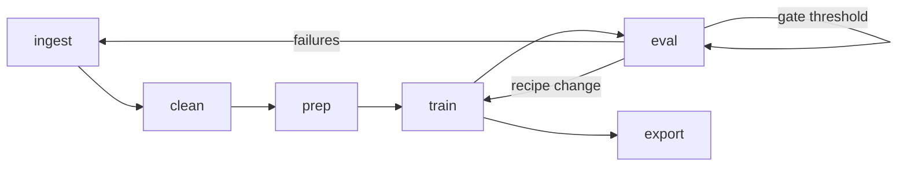

# Pipeline overview

BrewSLM's pipeline is **11 canonical stages**, defined once in `app/models/run_event.py` and used everywhere — the workspace steps, the readiness service, the timeline view, every `RunEvent`'s `stage` field.

For the conceptual primer see [Concepts → Pipeline stages](../concepts/pipeline-stages.md). This page is the practical map: where each stage lives, what it produces, and what the next page should be.

## The 11 stages

| # | Stage | Page | Produces |
|---|---|---|---|
| 1 | Ingestion | [Data ingestion](data-ingestion.md) | `RawDocument` rows under `DATA_DIR/projects/{id}/raw/`. |
| 2 | Cleaning | [Data ingestion](data-ingestion.md#step-2--clean) | Cleaned dataset version, PII stats. |
| 3 | Answer key | [Evaluation + remediation](evaluation-and-remediation.md#step-1--build-the-gold-set) | `GoldSetVersion` (the eval ground truth). |
| 4 | Synthetic | [Data ingestion](data-ingestion.md#optional--synthetic-augmentation) | Generated Q&A pairs joined to a dataset. |
| 5 | Dataset prep | [Data ingestion](data-ingestion.md#step-3--dataset-prep) | Normalised, deduped, split records. |
| 6 | Adapter preview | [Adapter examples](../getting-started/adapter-studio-examples.md) | Adapter contract for the data shape. |
| 7 | Tokenization | [Data ingestion](data-ingestion.md#tokenization) | Tokenized dataset under `prepared_dir/`. |
| 8 | Training | [Training](training.md) | Checkpoints + an immutable manifest. |
| 9 | Evaluation | [Evaluation + remediation](evaluation-and-remediation.md) | `EvalResult` rows. |
| 10 | Compression | [Export + deployment](export-and-deployment.md#compression) | Quantized weights. |
| 11 | Export | [Export + deployment](export-and-deployment.md) | Target-shaped deployable artifact. |

## Iteration loop, not waterfall

Don't read the table top-to-bottom and assume you only ever go forward. Real projects iterate:



A typical project does 3–5 iteration loops before its first deployment. The platform's job is to make those loops cheap (training manifest replay, pass/fail rule reuse, autopilot suggestions) — not to discourage them.

## What each stage needs

Steps are never locked in the UI: every page is reachable at any time. A stage can only *produce* something once its inputs exist, and the notices under each step bar point at the next step that can run.

| Stage | Needs |
|---|---|
| Cleaning | At least one ingested document. |
| Answer key / Synthetic | A cleaned dataset. |
| Dataset prep / Tokenization | A cleaned dataset (gold/synthetic are optional). |
| Training | A tokenized dataset + a selected base model. |
| Evaluation | A completed training run + an answer key + pass/fail rules (eval pack). |
| Compression / Export | A trained checkpoint. |

The same logic is what the [readiness service](../reliability/common-blockers.md) reports on for `brewslm doctor`.

## Where each stage lives in the UI

The project sidebar has six destinations, nothing else:

```
Overview                  → current stage, next step, latest run, shipped model
Data     (/data)          steps (?step=...):
│   ├── Sources           → ingestion
│   ├── Prepare           → cleaning       (?step=cleaning)
│   ├── Labels            → gold_set       (?step=goldset)
│   ├── Generate          → synthetic      (?step=synthetic)
│   └── Split             → dataset_prep   (?step=dataprep)
Train    (/train)         → one form (no steps) + the runs list below it
│   └── More options      → ?open=<id>: model, lora, seeds, checks, cloud,
│                           presets, plan, models, task, pipeline-presets,
│                           adapters, tokenization
Results  (/results)       → evaluation, four tabs: Verdict, Failures,
                            Compare, Try it (?tab=verdict|failures|compare|try)
Ship     (/ship)
│   ├── Package           → ?stage=package  (seed picker, New export, Releases;
│   │                       Options: ?open=compress, ?open=manifest)
│   ├── Publish           → ?stage=publish  (Hugging Face Hub)
│   ├── Deploy            → ?stage=deploy   (serve plans, Deployment Assistant)
│   └── Monitor           → ?stage=monitor  (timeline, failure clusters, support bundles)
Settings (/settings)      → tips switch, beginner flag, manifest export,
                            sections (?open=): Autopilot Planner, Workflow Builder,
                            Domain Packs, Domain Profiles, Extension Studio
                            (Pipeline presets, Adapter Studio live under Train;
                            Pipeline as Code under Ship)
```

Data Studio (`/data-studio`) and the Annotation list (`/annotate`) were retired on 2026-10-17: each **Data** step is a short form with a collapsed **Details** drawer whose sections load only when opened (`?open=<section-id>`), and the old pages' panels live there (table below). Related tools are linked from each page's header: the base model registry, task type, pipeline presets, Adapter Studio and tokenization live under **Train** → **More options**; the four evaluation workflows (Verdict, Failures, Compare, Try it) as tabs on **Results**; Deployments and Observability from **Ship**. Old `/pipeline/<tab>` URLs redirect to the matching destination and step; `/data-studio#<section>` redirects to the step and Details section below, and `/annotate` to **Labels** → *Annotation jobs*.

### Data steps and their Details sections

| Step (`?step=`) | The form on top | Details sections (`?open=`) |
|---|---|---|
| **Sources** (`data`) | Seed documents card, *Import dataset* (the import wizard), Upload | `documents` Ingested documents, `mappings` Saved import mappings, `readiness` Readiness, `eda` Exploratory analysis, `overview` Readiness overview, `sources` Sources summary, `assist` Assist |
| **Prepare** (`cleaning`) | Cleaning configuration + *Clean All Documents* | `results` Cleaning results, `errors` Cleaning errors, `label-noise` Label-noise review, `quality` Quality and safety, `domain` Domain detection |
| **Labels** (`goldset`) | Task shape card, Labelling conventions (span projects only), Gold Evaluation Dataset (answer key) card | `entries` Entries and human review, `workbench` Answer-key workbench, `review-queue` Review queue, `annotation` Annotation jobs (the keyboard labeler keeps its own page at `/annotate/<job_id>`) |
| **Generate** (`synthetic`) | Synthetic Data Generation form (modes, backend, count, Refine weak types, relabel / answer-key tools) | `playbooks` Playbooks, `review-queue` Review queue (synthetic), `spend` Spend and budget, `playbook-center` Playbook center, `recommendations` Recommendations, `quality` Synthetic quality |
| **Split** (`dataprep`) | Train / Val / Test split form (ratios, keep the test examples, stratify, dedup) | `health` Data health and leakage, `preview` Preview, schema and semantics, `adapters` Adapter preview, `mapping` Schema mapping, `prepare` Prepare checklist, `versions` Dataset versions |

#### Reviewing synthetic rows from different runs

Every synthetic row a playbook writes records the **Job** and **backend** that produced it (and whether it came through a Message Batch). In the Generate step's *Review queue*, **Group by → Job** or **Backend** puts each run's rows in its own group, labelled "job:12 · cloud:anthropic:&lt;model&gt; · &lt;mode&gt; · batch" so you can match it to the notification bell; the **Job** and **Backend** filters narrow the queue to one run. Rows written before this was recorded appear under "(no job)" / "(unknown backend)".

#### Pre-screening synthetic rows with a model

A project can hold thousands of pending synthetic rows. In the Generate step's *Review queue*, **Pre-screen with a model** picks a model (local, the local CLI, or a cloud model; an Anthropic model can run as a half-price Message Batch), an optional extra rubric (for instance the operations a plan may use) and how many rows to send per call (1 to 25). A background job gives each pending row a **pass**, **fail** or **unsure** verdict, a reason code and a one-sentence note; the bell shows "pass N · fail N · unsure N" and what it cost, and a budget stop keeps the verdicts already written. Rows are sent as data and the model is told to ignore instructions inside them; an answer that cannot be read, or two conflicting answers for one row, counts as *unsure*, never a pass. The model always sees the plan, code or answer being judged **whole** (only the cited passages are shortened, marked "[truncated]"); calls hold fewer rows when the rows are large, judging runs at temperature 0, and a row whose task and answer alone are too long to read whole is marked *unsure* (`too_long_to_judge`) for you to review by hand.

Nothing is accepted or rejected for you. Filter the queue by verdict or reason, or **Group by → Verdict + reason**, then use **Accept group** or **Reject group** (rejected groups are tagged `assist:<reason>`; the group is re-read just before acting, and *unsure* or not-pre-screened groups can be rejected but not accepted as a group). Running the pre-screen again replaces a row's earlier verdict.

## When to use which surface

Stage execution can happen on any of three surfaces. They write to the same underlying tables.

| You want to | UI | CLI | API |
|---|---|---|---|
| Explore a new dataset interactively | ✅ The workspace pages | — | — |
| Re-run a known-good config in CI | — | ✅ `brewslm train rerun` | ✅ `POST /api/projects/{id}/experiments/rerun` |
| Integrate with your data warehouse | — | — | ✅ `POST /api/projects/{id}/datasets/upload` |
| Demo to a stakeholder | ✅ The UI shows progress | — | — |
| Wire into Airflow / Argo | — | ✅ Every stage has a CLI verb | ✅ Equivalent endpoints |

## What each stage emits

Every stage emits at least one [RunEvent](../observability/run-events.md) per state transition (start, optional progress, end / failure). So the [timeline](../observability/timeline.md) is the right place to look back at "what happened in this project last Tuesday."

## Next

- [Data ingestion](data-ingestion.md) — stage 1 and 2.
- [Newbie autopilot](newbie-autopilot.md) — let the planner pick a path through stages 5–9.
- [Training](training.md) — stage 8 in detail.
- [Evaluation + remediation](evaluation-and-remediation.md) — stages 3 + 9.
- [Export + deployment](export-and-deployment.md) — stages 10 + 11 into a real serving env.
